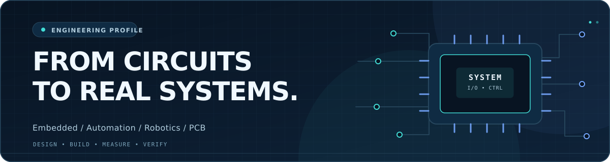

<picture>
  <source media="(prefers-color-scheme: dark)" srcset="./assets/hero-dark.svg" />
  <source media="(prefers-color-scheme: light)" srcset="./assets/hero-light.svg" />
  
</picture>

 

**Electrical Engineering & Automation @ UNETI · Vietnam**  
Building end-to-end engineering systems: **PCB → Firmware → Communication → Control → Validation**.

  
  
  

[GitHub stats](#github-stats) · [Activity](#contribution-activity) · [Projects](#featured-repositories) · [Stack](#engineering-stack) · [Contact](#contact)

---

## GitHub Stats

  
  

  

## Contribution Activity

  

Stats and repository cards are snapshots produced by GitHub Actions. The activity graph and streak card use public live services; these can temporarily be unavailable or cached. Numbers and language percentages are not a measure of engineering proficiency.

---

## Featured Repositories

  
  
  
  
  
  
  
  

[**View all repositories →**](https://github.com/TranDangKhoaAutomation?tab=repositories)

## Engineering Stack

| Focus | What I work on |
| :-- | :-- |
| **Embedded systems** | STM32, ESP32, C/C++, FreeRTOS, drivers and real-time control |
| **Hardware & PCB** | Schematic capture, component selection, PCB layout and bring-up |
| **Industrial interfaces** | UART, SPI, I²C, CAN, RS485 and Ethernet |
| **Robotics & automation** | Motor control, sensors, PID, robotics and PLC/HMI |
| **Engineering software** | Python automation, tooling and hardware/software integration |

<b>Engineering approach</b>

**Requirements → Design → Implementation → Measurement → Debugging → Verification**

I prefer official datasheets and existing source code over assumptions, instrumented testing over guesswork, and reproducible regression checks over unverified changes.

---

## Contact

For embedded firmware, electronics, automation or engineering software:

[**Email**](mailto:trandangkhoa.automation@gmail.com) · [**GitHub**](https://github.com/TranDangKhoaAutomation) · [**YouTube**](https://youtube.com/@TranDangKhoaTechnology) · [**Facebook**](https://www.facebook.com/OfficialTranDangKhoa)

HARDWARE / FIRMWARE / CONTROL / SOFTWARE

