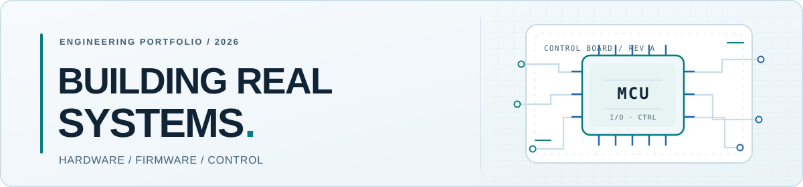

<picture>
  <source media="(prefers-color-scheme: dark)" srcset="./assets/hero-dark.svg" />
  <source media="(prefers-color-scheme: light)" srcset="./assets/hero-light.svg" />
  
</picture>

# Trần Đăng Khoa

**Electrical Engineering & Automation Student · UNETI · Vietnam**

I design and build practical systems across **embedded firmware, electronics, PCB design, robotics, and automation** — from the first schematic to an integrated, testable product.

  
  
  
  

[**Explore projects**](#featured-projects) · [**Tech stack**](#technology-stack) · [**Engineering approach**](#engineering-approach) · [**Contact**](#contact)

---

## About me

I'm an electrical engineering and automation student interested in making **hardware and software work as one reliable system**. My projects span microcontrollers, control algorithms, communication interfaces, custom PCBs, desktop tools, and real-world testing.

> **My system workflow:** Requirements → Schematic & PCB → Firmware → Communication → Application → Integration & verification

My focus is not only on making a prototype run, but on understanding **why it works, how it fails, and how to reproduce the result**.

## Engineering focus

- **Embedded & real-time control** — STM32, ESP32, C/C++, FreeRTOS, peripheral drivers, UART, SPI, I²C, CAN, and RS485.
- **Electronics & PCB** — component selection, circuit design, power stages, layout, hardware bring-up, and measurement.
- **Robotics & automation** — motor control, sensing, closed-loop control, PLC/HMI, safety logic, and fault recovery.
- **Engineering software** — Python utilities, dashboards, developer tooling, and integrated hardware/software workflows.

## Featured projects

A selection of public repositories that illustrate my work across the engineering stack.

### Embedded devices & control

**[Motor Control Deck](https://github.com/TranDangKhoaAutomation/Motor-Control-Deck)** — STM32-oriented motor-control tooling with USB CDC, UART communication, and testing for four motors.

**[CYD 2.8-inch Mini TV](https://github.com/TranDangKhoaAutomation/CYD-2.8Inch-Mini-Tivi)** — ESP32 touchscreen interface with video playback and network-based features.

  
  

### Robotics & developer infrastructure

**[Robot DHTD18A2HN 2025](https://github.com/TranDangKhoaAutomation/Robot_DHTD18A2HN_2025)** — ESP32 Bluetooth robot controlling DC motors and a servo-driven robotic arm.

**[Codex Plugin Bridge](https://github.com/TranDangKhoaAutomation/Codex-Plugin-Bridge)** — Windows-focused MCP bridge connecting AI assistants to scoped local engineering tools.

  
  

### More engineering projects

- **[STM32 FreeRTOS Multi-Task Demo](https://github.com/TranDangKhoaAutomation/STM32-FreeRTOS-Multi-Task-Demo)** — structured control, communication, logging, and safety-related tasks.
- **[Do Line](https://github.com/TranDangKhoaAutomation/Do_Line)** — line-following robot with PID control, derivative filtering, and adaptive speed.
- **[Altium Library](https://github.com/TranDangKhoaAutomation/Altium_Library)** — reusable schematic symbols and PCB footprints for Altium Designer.
- **[TranslateDub](https://github.com/TranDangKhoaAutomation/TranslateDub)** — browser extension for translated subtitles and synchronized text-to-speech dubbing.

[**Browse all my repositories →**](https://github.com/TranDangKhoaAutomation?tab=repositories)

## Technology stack

| Area | Tools & technologies |
| :--- | :--- |
| **Embedded firmware** | C, C++, STM32, ESP32, FreeRTOS, PlatformIO |
| **Electronics & PCB** | KiCad, Altium Designer, schematic capture, PCB layout |
| **Control & connectivity** | PLC, HMI, UART, SPI, I²C, CAN, RS485, Ethernet |
| **Software & tooling** | Python, Git, GitHub, VS Code, JavaScript |

## GitHub activity

Statistics and project cards are generated by this repository's scheduled GitHub Actions workflow; values may lag behind recent activity.

## Engineering approach

1. **Start with evidence.** Read the datasheet, define requirements, identify constraints, and inspect the existing design.
2. **Build for observability.** Include logs, test points, clear interfaces, and reproducible build steps.
3. **Verify the whole system.** Check electrical behavior, firmware logic, communication, failure handling, and regression risks.

The goal is maintainable engineering: **understand → design → implement → measure → debug → verify**.

---

## Contact

**Interested in embedded systems, automation, PCB design, or robotics?**

[Email](mailto:trandangkhoa.automation@gmail.com) · [GitHub](https://github.com/TranDangKhoaAutomation) · [YouTube](https://youtube.com/@TranDangKhoaTechnology) · [Facebook](https://www.facebook.com/OfficialTranDangKhoa)

Hardware · Firmware · Control · Software · Validation

